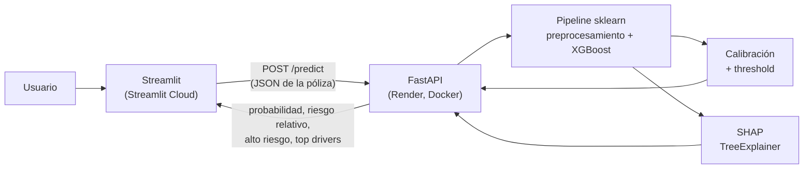

# Clasificador de riesgo de pólizas de seguro de auto

Modelo de machine learning que estima la probabilidad de que una póliza de auto tenga un **siniestro en los próximos 6 meses** y explica, póliza por póliza, **qué variables empujan ese riesgo** (SHAP). Incluye API (FastAPI), frontend (Streamlit), contenedores (Docker) y deploy público.

🔗 **App:** https://ml-insurance-risk.streamlit.app
🔗 **API (docs interactivas):** https://ml-insurance-risk.onrender.com/docs

> ⏳ La API corre en el plan gratuito de Render: se duerme tras ~15 min sin uso. La primera predicción puede tardar 30–60 s; las siguientes son inmediatas.

---

## Arquitectura



La app permite elegir pólizas reales del **test set** (que el modelo nunca vio) y compara la predicción con lo que realmente pasó (`is_claim`).

**Respuesta de la API** (`POST /predict`):
```json
{
  "data": {
    "probabilidad": 0.088,
    "riesgo_relativo": 1.4,
    "alto_riesgo": false,
    "drivers": [
      {"variable": "Antigüedad de la póliza", "valor_ingresado": 1.22, "impacto": 0.34, "efecto": "⬆️ sube el riesgo"},
      {"variable": "Zona", "valor_ingresado": "C8", "impacto": 0.09, "efecto": "⬆️ sube el riesgo"}
    ]
  },
  "error": null
}
```

---

## Datos

- **Fuente:** [Car Insurance Claim Prediction (Kaggle)](https://www.kaggle.com/datasets/ifteshanajnin/carinsuranceclaimprediction-classification)
- **58,592 pólizas**, 42 variables predictoras: datos de la póliza (antigüedad, zona), del asegurado (edad) y del auto (modelo, motor, equipamiento de seguridad, NCAP).
- **Desbalance fuerte:** solo el **6.4%** de las pólizas tuvo siniestro.
- `policy_tenure`, `age_of_car` y `age_of_policyholder` vienen **normalizadas (0–1)** en el dataset original, sin unidades reales.

---

## Resultados

Métrica principal: **PR-AUC** (average precision). Con clases tan desbalanceadas, ROC-AUC se infla por la clase mayoritaria y F1 depende de un threshold; PR-AUC mide qué tan bien el modelo *ordena* las pólizas por riesgo. Un modelo aleatorio obtiene PR-AUC ≈ prevalencia.

| | PR-AUC |
|---|---|
| Azar (prevalencia) | 0.062 |
| XGBoost — CV (5 folds) | 0.101 |
| **XGBoost — test** | **0.097** (~1.5x el azar) |

**Marcando como "alto riesgo" el top 20% de pólizas** (threshold 0.09, elegido en validación):

| Precisión | Recall | Lift |
|---|---|---|
| 10.4% | 34.4% | 1.69x |

**Cómo leerlo:** el modelo no sirve para predecir con certeza *qué* póliza tendrá un siniestro (de cada 10 marcadas, ~1 lo tiene), pero sí para **ordenar la cartera por riesgo**: el riesgo estimado varía ~9x entre el decil más bajo y el más alto, útil para priorizar revisiones o segmentar tarifas.

### ¿Qué impulsa el riesgo? (SHAP)

| Variable | Efecto en el modelo |
|---|---|
| **Antigüedad de la póliza** | La más importante. Pólizas nuevas bajan mucho el riesgo; antiguas lo suben. Consistente con exposición: más tiempo asegurado → más oportunidad de un siniestro. Confirmado en el EDA (3.3% → 8.8% de tasa de siniestros). |
| **Edad del auto** | Autos nuevos suben el riesgo, viejos lo bajan. Contraintuitivo; el efecto está parcialmente enmascarado por su relación con la antigüedad de la póliza. |
| **Zona** | Zonas con mayor tasa histórica de siniestros empujan hacia arriba. |
| **Edad del asegurado** | Efecto menor y con interacciones. |

En la práctica el modelo usa ~5–6 variables; las características técnicas del auto aportan poco.

> SHAP explica **lo que hace el modelo**, no causalidad.

---

## Decisiones técnicas

- **Split 70/15/15** (train/val/test) antes de ajustar cualquier transformación, para evitar leakage. Test se usó **una sola vez**, para el número final.
- **Preprocesamiento** en un `ColumnTransformer`: `StandardScaler` para numéricas, `TargetEncoder` para categóricas de alta cardinalidad (`model`, `area_cluster`, `engine_type`) y `OneHotEncoder` para el resto. Se eliminaron 8 variables colineales.
- **Desbalance:** `scale_pos_weight` (≈14.9) en lugar de SMOTE/resampling.
- **Selección de modelo:** Random Forest y XGBoost quedaron **estadísticamente empatados** (diferencia de PR-AUC menor que la variación entre folds). Se eligió **XGBoost** por ser ~4x más rápido en inferencia y más liviano (`max_depth=3`, 200 árboles).
- **Calibración:** `scale_pos_weight` infla las probabilidades (promedio ~46% vs 6% real). Se corrigió analíticamente (`odds / w`), lo que devuelve probabilidades realistas **sin alterar el ranking** (PR-AUC idéntico).
- **Threshold 0.09:** corresponde al top 20% de riesgo en validación; las pólizas marcadas tienen ≥1.4x el riesgo promedio.
- **API:** el pipeline completo (preprocesamiento + modelo) se guarda con `joblib` y acepta datos crudos. Validación de entrada con Pydantic (`Literal` para categóricas: una zona inexistente devuelve 422 en vez de una predicción silenciosa).

---

## Estructura

```
├── api/                  # FastAPI: endpoints (main.py) + lógica ML (predictor.py)
├── app/                  # Streamlit: intro + predictor
│   └── app_info/         # test set usado por la app
├── models/               # pipeline entrenado (xgb_pipeline.joblib)
├── notebooks/            # EDA y modelado
├── docker-compose.yml
└── requirements.txt      # entorno de desarrollo completo
```

Cada servicio tiene su propio `Dockerfile` y `requirements.txt` mínimo.

---

## Correr localmente

**Con Docker (recomendado):**
```bash
docker compose up --build
```
- App: http://localhost:8501
- API: http://localhost:8000/docs

**Sin Docker** (Python 3.11):
```bash
pip install -r requirements.txt
uvicorn api.main:app --reload          # terminal 1
streamlit run app/streamlit_app.py     # terminal 2
```

---

## Limitaciones y siguientes pasos

- **Poder predictivo modesto** (PR-AUC 0.097): el dataset no incluye historial del conductor (siniestros previos, infracciones), que suele ser el predictor más fuerte en seguros. *Hipótesis no verificada.*
- El split no es estratificado; validación quedó con algo más de siniestros (7.0%) que train (6.3%).
- Variables de edad/antigüedad normalizadas sin unidades reales, lo que limita la interpretación.
- Posibles mejoras: curva de aprendizaje para verificar si más datos ayudarían, imagen de API más liviana (`xgboost-cpu`), filtros en la app.

---

## Stack

Python 3.11 · pandas · scikit-learn · XGBoost · SHAP · FastAPI · Pydantic · Streamlit · Docker · Render · Streamlit Community Cloud
